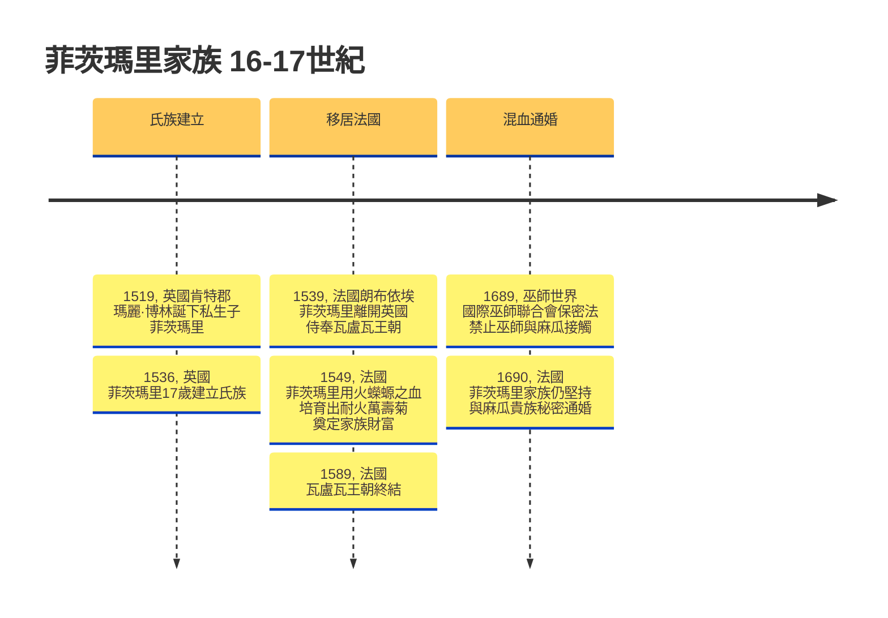
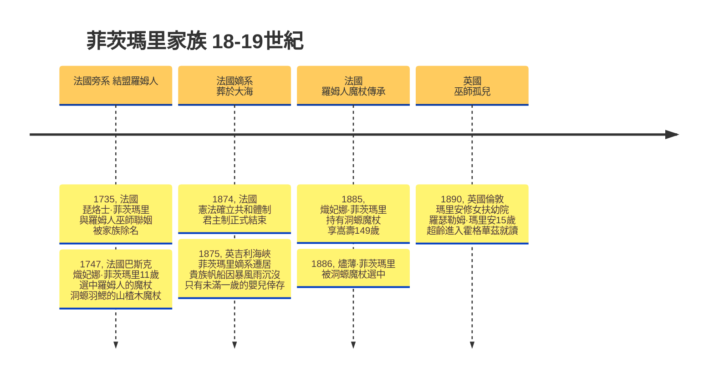
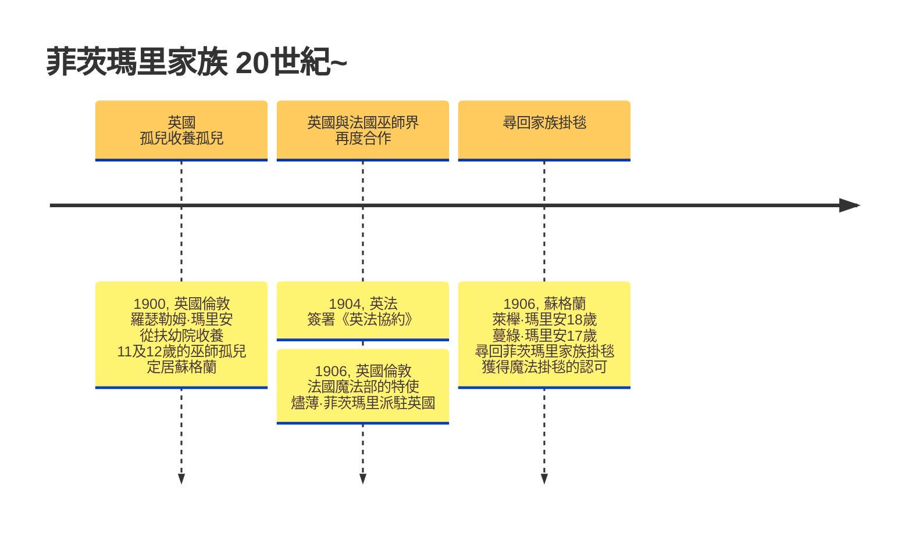

# 霍格華茲-c821118擴充資料庫
作者：HackMD@c821118 | Threads@shibani11187

## 巫師家族
### 菲茨瑪里(Fitzmarie)
- 【起源巫師】：1536年，安妮·博林死後，她的姪子17歲的菲茨瑪里(Fitzmarie)成立新的巫師氏族，並成為博林巫師血脈中仍存活且最強大的巫師，但作為私生子而不被冠有博林之姓；其血脈可追溯法蘭西國王法蘭索瓦一世及女巫瑪麗·博林(Mary Boleyn)。
- 【起源宅邸】：位於英格蘭東南部肯特郡(Kent)的赫弗城堡(Hever Castle)；16世紀時，赫弗城堡曾屬於博林家族的湯瑪斯·博林（Thomas Boleyn）。
- 【家族徽章】：菲茨瑪里家徽是全身開滿萬壽菊(Marigold)的火蠑螈(Salamander)；象徵法蘭索瓦一世的血脈在火焰中誕生、吞食火苗，背上的斑點卻綻放象徵瑪麗·博林的萬壽菊，然而，萬壽菊綻放後再度被火焰灼燒枯萎，成為「自我吞食者」，家訓"Nutrisco et extinguo."
- 【家傳寶物】：一幅繡有萬壽菊火蠑螈自我吞食過程的掛毯，織製者是巫師瑪麗·博林，製作於1536年。
- 【性格風評】：菲茨瑪里的家族成員皆執著於復仇、聲譽與自我證明。因其血脈來自於麻瓜國王與女巫師，因此被純血巫師認為是「混血家族」，菲茨瑪里卻是少數推崇混血的家族，但他們只允許擁有貴族身分的麻瓜混入血脈之中。
- 【後代子孫】：菲茨瑪里家族的成員都將在17歲被家族魔法掛毯認可，這與初代菲茨瑪里被認可的年齡相同。菲茨瑪里家族散落於，堅持魔法根源的英國東南部派，以及追隨法國王室的法國中北部派。

#### 火焰 菲茨瑪里家族
- 菲茨瑪里(Fitzmarie, 1519-1627)：復仇→聲譽→自我證明
- 琵烙士·菲茨瑪里(Pyrrhus Fitzmarie, 1710-1821)：復仇→自我證明
- 熾妃娜·菲茨瑪里(Seraphina Fitzmarie, 1736-1885)：聲譽→自我證明
- 燼薄·菲茨瑪里(Ember Fitzmarie, 1875-)：聲譽
- 炎涅休·菲茨瑪里(Ignatius Fitzmarie)

#### 花草 瑪里安家族
- 羅瑟勒姆「迷迭香」·瑪里安(Rotherham "Rosemary" Marian, 1875-失蹤1930)：自我證明→復仇
- 萊櫸·瑪里安(Lafayette Marian, 1888-)：復仇→自我證明
- 蔓綠·瑪里安(Marley Marian, 1889-)：聲譽

## 魔法學術架構
### 羅姆人巫師(Romani Wizard)
- 【自然崇拜】：其他巫師認為萬物皆具魔法，而羅姆人巫師認為萬物皆有靈，相信泛靈論，差別在於羅姆人巫師認為魔法是「施展/運用」，萬物靈則是透過「溝通」，擅長與萬物溝通能壯大自然魔法。
- 【自然專精】：羅姆人巫師擅長藥草學、算命學、占卜學，以及無杖魔法。
- 【羅姆的守靈夜(The Romani's Wake)】：
    - 【羅姆的守靈夜】是掌握生死的古老魔法，屬於羅姆人巫師的血脈專精魔法。源自羅姆人的守靈儀式，透過傳統歌曲及舞蹈慶祝亡者的一生，亡者的遺物視為「不潔(Marimé)」，必須燒毀遺物切斷祂們在生界的牽絆，確保亡者不會化成行屍(Mulo)返回生界。
    - 當場地中有「行屍」、「亡者」或「將死之人」，羅姆人巫師透過詠唱守靈歌曲或是展現舞步，將會促使守靈夜成立。
    - 舉行守靈夜的羅姆人巫師會被魔法判定為主持儀式的「守靈人」；主持過守靈夜的巫師，身上會帶有類似死神的氣息，被亡靈畏懼（包含已死之人的畫像） 。
    - 儀式必須持續到將死之人死去，或是行屍及亡者返回亡界為止，因此儀式的舉行取決於「守靈人」的魔法及生命力。
    - 儀式普遍需要三名以上的巫師舉行，如果數量少於三名，將會大幅消耗「守靈人」巫師的生命力（可能致死）。如果儀式被打斷，則會反噬巫師，被迫強加不潔(Marimé)的印記，被死神跟蹤。
    - 精通【羅姆的守靈夜】的巫師能夠透過詠唱羅姆歌曲或展現舞步，從某處、某物或某人驅散帶有死亡氣息的魔法（包含黑魔法），但是魔法無法被消除，只能被轉移或是送回亡界。
    - 水域被視為渡化媒介，水界線代表生與死的分野；水域可以在【羅姆的守靈夜】中被轉化成通往亡界的通道，直到儀式結束。

## 魔杖學與巫師特質配對
### 魔杖芯
- 【蠑螈羽鰓】：環境與魔法感知極度敏銳，契合高階變形學與細緻符咒，主動挑選擅長適應局勢變遷的巫師。對使用者的「違背真心」極度敏感，一旦使用者委屈自身意願、硬撐，魔杖將瞬間陷入沉睡；反之，徹底接納自身本質的巫師能激發出超越常理的強大魔法。
適合搭配的紫杉木、山楂木或柳木。其施法專精受「亞種來源」的影響：
    - 【火蠑螈幼態羽鰓】：汲取自火蠑螈(Salamander)的幼態時期，主人專精火焰或熱能相關的符咒。
    - 【鰻螈羽鰓】：汲取自長得像鰻魚的水棲蠑螈，主人專精水體或液體相關的符咒。
    - 【鈍口螈羽鰓】/【洞螈羽鰓】：汲取自一種永遠維持在幼態時期的蠑螈，主人專精再生、醫療魔法，以及延緩狀態的時間魔法。
    - 【山椒魚羽鰓】：汲取自隱匿於高山溪流的遠古蠑螈，主人專精岩石、土地相關的自然魔法，以及對抗極端惡劣環境的防護魔法。

### 木材
### 台灣魔杖木材
- 【紅檜木】：契合沉穩內斂、背負家族傳承，且意志極其堅韌的巫師。極度排斥速成的黑魔法。
- 【肖楠木】：契合心思純粹、具精神潔癖的巫師。在破除遠古詛咒與驅逐黑暗生物時威力倍增。
- 【撞天杉木】：契合眼界極高、抱負遠大且試圖打破傳統的先驅者。於高空飛行與氣象魔法天賦異稟。
- 【樟木】：契合靈活務實、適應力極強，能在各魔法領域皆有所成的巫師。魔杖展現極佳的泛用性。
- 【正榕木】：契合重視根基、具備強大庇護欲，或與靈魂世界（幽靈）有著深刻連結的內斂巫師。